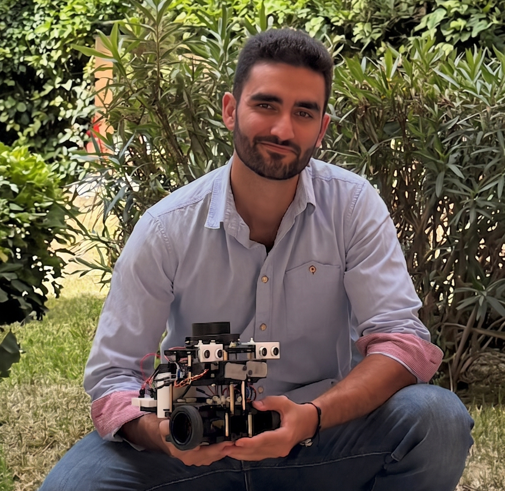

---
hide:
  - navigation
---

# Adrián Bañuls Arias

{ .profile-photo }

Predoctoral researcher at the [University of Málaga](https://www.uma.es/), where I
work with the [UnCORE](https://github.com/uncore-team) and
[MAPIR](https://mapir.isa.uma.es/) research groups.

My research focuses on **reinforcement learning for mobile robots**: how to deploy
learned policies on real hardware, how the choice of timestep affects learning, and
time-aware navigation.

I'm currently working on the
[TYRELL](https://babel.isa.uma.es/research/projects/tyrell/) project (Time-Ready
Reinforcement Learning for Robotic Skills and Tasks).

## Contact

- Email: [adrianb_arias@uma.es](mailto:adrianb_arias@uma.es)
- GitHub: [AdrianBanulsA](https://github.com/AdrianBanulsA)
- ORCID: [0009-0004-8712-0431](https://orcid.org/0009-0004-8712-0431)

See my [publications](publications.md).
